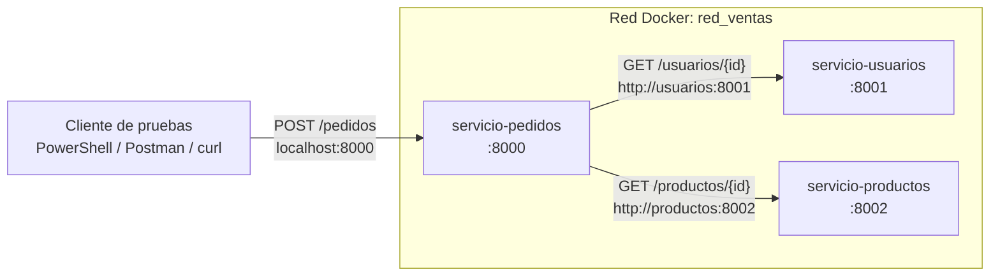

# Laboratorio: sistema de ventas distribuido con Docker

Tres servicios Flask independientes (usuarios, productos y pedidos), cada uno en su propio contenedor, conectados por una red interna de Docker y comunicados mediante HTTP y JSON.

## Trabajo en equipo con Git

Todos los integrantes trabajan sobre este mismo repositorio. Cada uno modifica solo la carpeta de su rol para no pisar el trabajo de otros.

| Integrante | Carpeta o archivos a su cargo |
|---|---|
| 1 | `usuarios/app.py`, `usuarios/requirements.txt` |
| 2 | `productos/app.py`, `productos/requirements.txt` |
| 3 | `pedidos/app.py`, `pedidos/requirements.txt` |
| 4 | Los tres `Dockerfile` y `docker-compose.yml` |
| 5 | Revisión, pruebas y evidencias |

Clonar el repositorio (una sola vez):

```
git clone <URL-del-repositorio>
cd laboratorio-ventas
```

Antes de empezar a trabajar, traer los cambios de los demás:

```
git pull
```

Después de modificar sus archivos, subirlos:

```
git add .
git commit -m "Describe brevemente el cambio"
git push
```

Después de cada `git pull` que traiga cambios en el código, reconstruir los contenedores con `docker compose up -d --build`.

## Arquitectura



| Servicio  | Contenedor           | Puerto | Endpoints                                                  |
|-----------|----------------------|--------|------------------------------------------------------------|
| usuarios  | servicio-usuarios    | 8001   | `GET /salud`, `GET /usuarios`, `GET /usuarios/<id>`        |
| productos | servicio-productos   | 8002   | `GET /salud`, `GET /productos`, `GET /productos/<id>`      |
| pedidos   | servicio-pedidos     | 8000   | `GET /salud`, `GET /pedidos`, `POST /pedidos`              |

Datos de prueba:

- Usuarios: U01 Ana (activo), U02 Carlos (activo), U03 Luisa (inactivo).
- Productos: P01 Audífonos ($50.000, 10 unidades), P02 Teclado ($120.000, 5), P03 Mouse ($35.000, 0).

Códigos de respuesta de `POST /pedidos`: 201 pedido creado, 400 datos inválidos, 404 usuario o producto inexistente, 409 usuario inactivo o existencias insuficientes, 503 un servicio no responde.

## Estructura de archivos

```
laboratorio-ventas/
├── docker-compose.yml
├── README.md
├── usuarios/
│   ├── app.py
│   ├── Dockerfile
│   └── requirements.txt
├── productos/
│   ├── app.py
│   ├── Dockerfile
│   └── requirements.txt
└── pedidos/
    ├── app.py
    ├── Dockerfile
    └── requirements.txt
```

Cada servicio tiene su propio `requirements.txt` porque cada imagen se construye por separado y solo debe incluir lo que necesita: usuarios y productos solo usan Flask; pedidos usa además `requests` para llamar a los otros servicios.

## Requisitos

- Docker Desktop instalado y **abierto** (el ícono de la ballena debe indicar que está en ejecución).
- Windows 10/11 con PowerShell, o macOS (Intel o Apple Silicon) con Terminal.
- Puertos 8000, 8001 y 8002 libres.

Comprobar Docker:

```powershell
docker --version
docker compose version
```

Resultado esperado: ambos comandos muestran una versión. Si aparece un error de conexión con el "Docker daemon", Docker Desktop no está abierto.

---

## Paso 1. Crear las carpetas y archivos

Descomprimir el proyecto o crear la estructura anterior y copiar el contenido de cada archivo. Luego entrar a la carpeta:

```powershell
cd ruta\a\laboratorio-ventas
dir
```

Resultado esperado: se ven `docker-compose.yml`, `README.md` y las carpetas `usuarios`, `productos` y `pedidos`.

## Paso 2. Construir las imágenes y levantar los contenedores

```powershell
docker compose up -d --build
```

`--build` construye las tres imágenes a partir de cada Dockerfile y `-d` deja los contenedores ejecutándose en segundo plano. La primera vez tarda uno o dos minutos porque descarga la imagen `python:3.12-slim`.

Resultado esperado al final:

```
✔ Network red_ventas            Created
✔ Container servicio-usuarios   Started
✔ Container servicio-productos  Started
✔ Container servicio-pedidos    Started
```

## Paso 3. Comprobar que los tres servicios están en ejecución

```powershell
docker compose ps
```

Resultado esperado: tres filas (`servicio-usuarios`, `servicio-productos`, `servicio-pedidos`) con estado `Up` o `running` y los puertos `0.0.0.0:8001->8001/tcp`, `0.0.0.0:8002->8002/tcp` y `0.0.0.0:8000->8000/tcp`.

Consultar la ruta de salud de cada uno:

```powershell
Invoke-RestMethod http://localhost:8001/salud
Invoke-RestMethod http://localhost:8002/salud
Invoke-RestMethod http://localhost:8000/salud
```

Resultado esperado: cada uno responde con su nombre de servicio, `estado: en ejecución` y un valor `contenedor` **distinto** (es el ID corto de cada contenedor). Compararlo con la columna `CONTAINER ID` de `docker ps`.

También se pueden consultar los datos:

```powershell
Invoke-RestMethod http://localhost:8001/usuarios
Invoke-RestMethod http://localhost:8002/productos
```

## Preparación de las pruebas de compra (PowerShell)

`Invoke-RestMethod` lanza una excepción cuando la respuesta es un error (4xx o 5xx) y oculta el cuerpo JSON. Para ver siempre el código HTTP y el JSON, pegar esta función una vez en la ventana de PowerShell (funciona en Windows PowerShell 5.1 y en PowerShell 7):

```powershell
function Enviar-Pedido($usuario, $producto, $cantidad) {
    $cuerpo = @{ usuario_id = $usuario; producto_id = $producto; cantidad = $cantidad } | ConvertTo-Json
    try {
        $r = Invoke-WebRequest -Uri "http://localhost:8000/pedidos" -Method Post `
             -ContentType "application/json" -Body $cuerpo -UseBasicParsing
        "HTTP $($r.StatusCode)"
        $r.Content | ConvertFrom-Json | ConvertTo-Json -Depth 5
    } catch {
        "HTTP $([int]$_.Exception.Response.StatusCode)"
        $_.ErrorDetails.Message | ConvertFrom-Json | ConvertTo-Json -Depth 5
    }
}
```

Si se cierra la ventana de PowerShell, hay que volver a pegar la función.

## Paso 4. Compra válida

```powershell
Enviar-Pedido U01 P01 2
```

Resultado esperado:

```
HTTP 201
{
    "mensaje":  "Pedido creado correctamente",
    "pedido":  {
                   "cantidad":  2,
                   "fecha_utc":  "2026-10-22T21:54:10+00:00",
                   "id":  "PED-0001",
                   "precio_unitario":  50000,
                   "producto":  { "id":  "P01", "nombre":  "Audífonos" },
                   "total":  100000,
                   "usuario":  { "id":  "U01", "nombre":  "Ana" }
               }
}
```

La disposición exacta de espacios varía según la versión de PowerShell, la fecha cambia y el ID aumenta con cada pedido. Para ver los pedidos guardados en memoria:

```powershell
(Invoke-WebRequest http://localhost:8000/pedidos -UseBasicParsing).Content
```

## Paso 5. Usuario inexistente

```powershell
Enviar-Pedido U99 P01 1
```

Resultado esperado:

```
HTTP 404
{ "error":  "El usuario U99 no existe" }
```

## Paso 6. Cantidad superior a las existencias

```powershell
Enviar-Pedido U01 P01 50
```

Resultado esperado:

```
HTTP 409
{ "error":  "Existencias insuficientes de Audífonos: se solicitaron 50 y solo hay 10" }
```

Pruebas adicionales de validación:

| Comando                   | Código | Mensaje esperado                                        |
|---------------------------|--------|---------------------------------------------------------|
| `Enviar-Pedido U01 P01 0` | 400    | La cantidad debe ser un número entero mayor que cero    |
| `Enviar-Pedido U03 P01 1` | 409    | El usuario U03 no está activo                           |
| `Enviar-Pedido U01 P99 1` | 404    | El producto P99 no existe                               |
| `Enviar-Pedido U01 P03 1` | 409    | Existencias insuficientes de Mouse: se solicitaron 1 y solo hay 0 |

## Paso 7. Consultar los registros de ejecución

Registros de los tres servicios juntos:

```powershell
docker compose logs
```

Registros de un servicio y seguimiento en vivo (salir con Ctrl+C):

```powershell
docker compose logs -f pedidos
```

Resultado esperado después de la compra válida, en `pedidos`:

```
[pedidos] Solicitud recibida: {'usuario_id': 'U01', 'producto_id': 'P01', 'cantidad': 2}
[pedidos] -> GET http://usuarios:8001/usuarios/U01
[pedidos] <- 200 desde el servicio de usuarios
[pedidos] -> GET http://productos:8002/productos/P01
[pedidos] <- 200 desde el servicio de productos
[pedidos] Pedido PED-0001 creado. Total: 100000
```

Y en `usuarios` (la IP es la del contenedor de pedidos, puede variar):

```
[usuarios] Consulta del usuario U01 desde 172.18.0.4
172.18.0.4 - - [...] "GET /usuarios/U01 HTTP/1.1" 200 -
```

Esto demuestra que la solicitud llegó a usuarios **desde otro contenedor** a través de la red interna, no desde el cliente. Las líneas `WARNING: This is a development server` son normales en un laboratorio (ver limitaciones).

## Paso 8. Detener y volver a iniciar el sistema

```powershell
docker compose stop
docker compose ps -a
docker compose start
```

Resultado esperado: tras `stop`, los contenedores aparecen como `Exited`; tras `start`, vuelven a `Up`. Al consultar de nuevo `(Invoke-WebRequest http://localhost:8000/pedidos -UseBasicParsing).Content` el resultado es `[]`: los pedidos estaban en memoria y se perdieron al detener el proceso.

Para eliminar contenedores y red, y luego recrearlos:

```powershell
docker compose down
docker compose up -d
```

`down` elimina los contenedores y la red `red_ventas` pero conserva las imágenes, así que `up -d` es rápido. Si se modifica algún `app.py`, usar `docker compose up -d --build`.

## Paso 9. Comprobar la comunicación y la independencia

### 9.1 Red de Docker

```powershell
docker network ls
docker network inspect red_ventas --format "{{range .Containers}}{{.Name}} {{.IPv4Address}}{{println}}{{end}}"
```

Resultado esperado: aparece `red_ventas` y los tres contenedores con una IP distinta cada uno (por ejemplo `172.18.0.2/16`, `.3`, `.4`).

### 9.2 Resolución por nombre de servicio (DNS interno)

Ejecutar una petición desde **dentro** del contenedor de pedidos usando el nombre `usuarios`:

```powershell
docker compose exec pedidos python -c "import requests; print(requests.get('http://usuarios:8001/salud').text)"
```

Resultado esperado: el JSON de salud del servicio de usuarios.

Repetir con `localhost`:

```powershell
docker compose exec pedidos python -c "import requests; print(requests.get('http://localhost:8001/salud').text)"
```

Resultado esperado: un error que termina en `Connection refused`. Dentro del contenedor de pedidos, `localhost` es el propio contenedor de pedidos, donde no hay nada escuchando en el puerto 8001. Por eso el servicio usa `http://usuarios:8001`.

### 9.3 Contenedores separados con kernel compartido

```powershell
docker compose top
docker compose exec usuarios hostname
docker compose exec productos hostname
docker compose exec usuarios uname -r
docker compose exec productos uname -r
docker stats --no-stream
```

Resultado esperado: `top` muestra un proceso `python app.py` en cada contenedor; los `hostname` son distintos; los dos `uname -r` muestran **la misma** versión de kernel Linux (la de la máquina virtual ligera que usa Docker Desktop, por ejemplo terminada en `microsoft-standard-WSL2` en Windows o `linuxkit` en Mac); `docker stats` muestra CPU y memoria de cada contenedor por separado.

### 9.4 Fallo del servicio de productos

```powershell
docker compose stop productos
Invoke-RestMethod http://localhost:8001/usuarios/U01
Enviar-Pedido U01 P01 1
docker compose logs --tail 6 pedidos
```

Resultado esperado: usuarios sigue respondiendo con los datos de Ana (es independiente), pero la compra devuelve:

```
HTTP 503
{ "error":  "El servicio de productos no está disponible. Intente más tarde." }
```

En los registros de pedidos se ve que la consulta a usuarios respondió 200 y la consulta a productos falló con un error de resolución de nombre (`Failed to resolve 'productos'` o `NameResolutionError`): al detenerse el contenedor, el DNS de Docker deja de resolver ese nombre.

Recuperar el servicio y repetir:

```powershell
docker compose start productos
Enviar-Pedido U01 P01 1
```

Resultado esperado: `HTTP 201`. No fue necesario reiniciar pedidos ni usuarios.

### 9.5 Independencia del servicio de pedidos

```powershell
docker compose stop pedidos
Invoke-RestMethod http://localhost:8001/salud
Invoke-RestMethod http://localhost:8002/salud
docker compose start pedidos
```

Resultado esperado: usuarios y productos responden aunque pedidos esté detenido.

## Paso 10. Cada servicio en un computador distinto

Los pasos anteriores corren los tres contenedores en un mismo equipo. Para repartirlos, cada computador levanta un solo servicio con su propio archivo compose, y pedidos llega a los otros dos por la **IP de cada equipo**. En ningún caso se usa `localhost`.

| Computador | Servicio | Archivo | Puerto |
|---|---|---|---|
| A | usuarios  | `docker-compose.computador-a.yml` | 8001 |
| B | productos | `docker-compose.computador-b.yml` | 8002 |
| C | pedidos   | `docker-compose.computador-c.yml` + `.env` | 8000 |

Resumen (la guía paso a paso completa está en el documento del grupo):

1. Los tres equipos en la misma red (mismo Wi-Fi o Tailscale). Cada uno anota su IP con `ipconfig` (Windows) o `ipconfig getifaddr en0` (Mac).
2. En Windows, abrir el puerto del servicio en PowerShell como administrador (8001 en A, 8002 en B, 8000 en C):

   ```powershell
   New-NetFirewallRule -DisplayName "Laboratorio ventas" -Direction Inbound -Protocol TCP -LocalPort 8001 -Action Allow -Profile Any
   ```

3. A y B levantan su servicio:

   ```powershell
   docker compose -f docker-compose.computador-a.yml up -d --build   # en A
   docker compose -f docker-compose.computador-b.yml up -d --build   # en B
   ```

4. C copia `.env.ejemplo` como `.env`, escribe las IP de A y B, y levanta pedidos:

   ```powershell
   Copy-Item .env.ejemplo .env
   notepad .env
   docker compose -f docker-compose.computador-c.yml up -d --build
   ```

   `.env` está en `.gitignore` porque las IP cambian según el equipo y la red.

5. Las pruebas se hacen desde cualquier equipo con la IP de C, por ejemplo `Invoke-RestMethod http://192.168.0.12:8000/salud`. En `Enviar-Pedido`, cambiar `localhost` por la IP de C.

Resultado esperado: las compras funcionan igual que en un solo equipo, y en `docker compose -f docker-compose.computador-c.yml logs pedidos` las líneas `->` muestran las IP de A y B.

---

## Equivalentes en macOS (Terminal)

Los comandos `docker` y `docker compose` son idénticos. Solo cambian las peticiones HTTP, que se hacen con `curl`:

```bash
# Salud y consultas
curl http://localhost:8001/salud
curl http://localhost:8002/productos

# Compra válida
curl -s -X POST http://localhost:8000/pedidos \
  -H "Content-Type: application/json" \
  -d '{"usuario_id":"U01","producto_id":"P01","cantidad":2}' \
  -w "\nHTTP %{http_code}\n"

# Usuario inexistente / existencias insuficientes: cambiar el JSON
#   {"usuario_id":"U99","producto_id":"P01","cantidad":1}
#   {"usuario_id":"U01","producto_id":"P01","cantidad":50}

# Pedidos en memoria
curl http://localhost:8000/pedidos
```

En la salida de `curl`, las tildes aparecen como `\u00ed`, `\u00e1`, etc. Es la forma estándar de JSON de representar esos caracteres; PowerShell y Postman los muestran normalmente.

## Pruebas con Postman

- Método `POST`, URL `http://localhost:8000/pedidos`.
- Pestaña Body → raw → JSON:

```json
{ "usuario_id": "U01", "producto_id": "P01", "cantidad": 2 }
```

Postman muestra el código (201, 404, 409, 503) y el JSON de respuesta.

## Solución de problemas

| Síntoma | Causa probable | Solución |
|---|---|---|
| `error during connect` o `Cannot connect to the Docker daemon` | Docker Desktop cerrado | Abrir Docker Desktop y esperar a que inicie |
| `port is already allocated` | Otro programa usa 8000, 8001 u 8002 | Cerrar ese programa o cambiar el puerto izquierdo en `ports` del compose |
| `No se puede conectar con el servidor remoto` en PowerShell | Contenedores detenidos | `docker compose ps` y luego `docker compose up -d` |
| Los cambios en `app.py` no se reflejan | La imagen no se reconstruyó | `docker compose up -d --build` |
